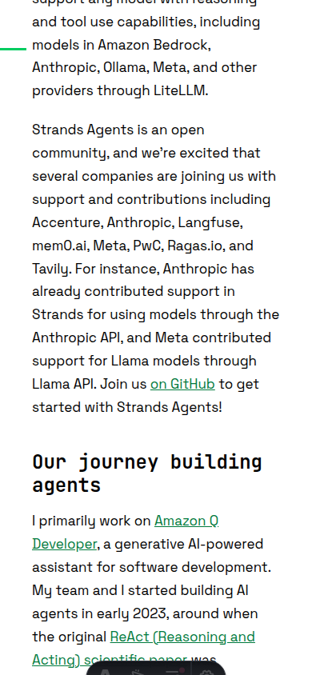
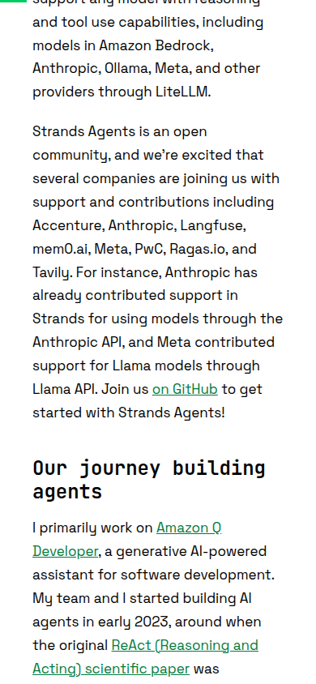

# Blog reading-progress validation

Evidence for strands-agents/harness-sdk#5436 (fixing #5420).

Tested source commit: `f427c50838842a1b250df3a103fb50a3c32ad8b7`.
All verification below was performed by browser automation and local commands. Human line review was confirmed separately; no human personal-test claim is made.

## Visual result

At the same blog route, 390×844 viewport and scroll position 1800px:

| Before | After |
| --- | --- |
|  |  |

The hidden header's bottom is 0px. Before the fix, the bar's top remained 60px; after the fix, it is 0px. Reverse scrolling restores the bar beneath the visible header at 60px.

Additional screenshots: [header returned](after-mobile-header-returned.png), [dark mobile](after-mobile-dark.png), [desktop](after-desktop.png).

## Browser coverage

Actual Astro route `/blog/introducing-strands-agents/`, both development and built production preview. Light and dark themes at 320×640, 390×844, 1280×900, and 1024×400. Checks exercise real document scrolling, header hidden/visible/reverse-scroll states, compact-to-desktop resize and back, reduced motion, and `?embed` (bar hidden).

`npm run test:browser` failed on the original layout and passed on the fix. It uses `BLOG_TEST_URL` to select the running site and optionally `CHROMIUM_EXECUTABLE` to select an installed browser. The recorded run used `BLOG_TEST_URL=http://127.0.0.1:4328` and an existing Chromium 145 executable. Runner: Playwright 1.64.1; browser: Chrome for Testing 145.0.7632.6; Node 22.22.1; npm 10.9.4.

Logs: [expected failure before](before.log), [passing production browser run](production-browser.log).

## Local quality checks

`PATH=<task Python environment>/bin:$PATH ASTRO_TELEMETRY_DISABLED=1 NODE_OPTIONS=--max-old-space-size=4096 bash .agents/skills/pre-push/run-checks.sh`

- Full site/API documentation build passed: 1,151 built pages, 1,427 HTML files including legacy routes; no broken links.
- Site typecheck and snippet typecheck passed.
- Unit tests: 43 files passed; 653 tests passed, 2 skipped.
- Scoped formatting and diff checks passed.

Full output: [pre-push-final.log](pre-push-final.log).

The independent `npm run format:check` reports six unchanged documentation snippet files on both base and patched trees: [base output](format-baseline.log), [patched output](format.log). [Changed package/test files pass Prettier](changed-format.log). These pre-existing formatting issues were left outside this layout fix.

The API docs were generated and the content snapshot refreshed before the final checks. The local SDK was built to supply snippet type declarations. CI, maintainer review, and preview deployment are separate from these local results.
